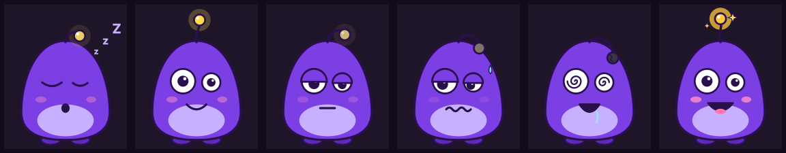

# Fuzmo

Fuzmo is a little purple creature who goes to bed when you do. He gets drowsy at your bedtime, falls asleep when your phone goes down, and each morning tells you, affectionately, how the night went. An Android app for adults who scroll in bed.

**Status:** pre-MVP. A 2-week WhatsApp concierge test validates the idea while an agent factory grills the docs and drafts the spec.

## What's here

| Path | What it is |
| --- | --- |
| `docs/product-brief.md` | What we're building now: the nightly loop, the night model, MVP scope, validation gates |
| `docs/strategy.md` | Full product strategy and market research behind the brief |
| `GLOSSARY.md`, `docs/adr/` | Domain language and hard-to-reverse decisions |
| `docs/factory/FACTORY.md` | How the hourly agent factory works |
| `design/` | Fuzmo's art: mood SVGs, the character sheet source, and a renderer |
| `.claude/skills/` | [Matt Pocock's skills](https://github.com/mattpocock/skills) (MIT), vendored |

## How it gets built

An hourly scheduled Claude run walks Matt Pocock's skill chain, one step per run:

1. **Grill with docs:** question rounds posted on a `factory:grill` issue. Answer in a comment ("1 yes, 2 no: …").
2. **Spec:** published as a `factory:spec` issue. Reply `/approve`.
3. **Tickets:** a breakdown posted on the spec issue. Reply `/approve` or suggest changes; then tracer-bullet issues appear.
4. **Implement:** one ticket per run, test-first, as a `factory:pr` pull request. Review and merge it.
5. **Retro:** every 5 merged PRs, a `factory:retro` PR improves the process.

Progress is logged on [the factory log issue](https://github.com/wernerh/fuzmo/issues/1). To stop everything, add a `PAUSE` file to `main` or put the `factory:pause` label on any open issue.

## Credits

The skills in `.claude/skills/` are by Matt Pocock, MIT licensed; see `.claude/skills/LICENSE.mattpocock-skills`.
